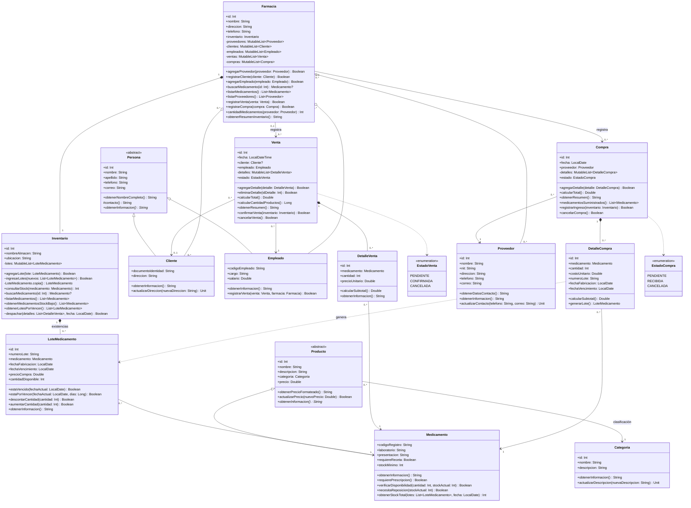

# Modelo de dominio de Farmacia Miranda

Los detalles admiten multiplicidad 0..* mientras se prepara un documento y 1..* al confirmar una venta o recibir una compra. El inventario es propiedad de una farmacia y mantiene copias privadas de sus lotes. Los detalles representan líneas de valor de su documento.

La visibilidad sigue UML: + pública, − privada y # protegida. ~ representa el acceso interno del módulo Kotlin. En las propiedades con escritura restringida se muestra la visibilidad del getter. El asterisco al final de una operación Mermaid indica que es abstracta. Las firmas omiten los valores predeterminados de Kotlin.
